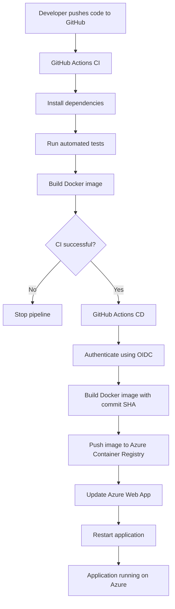

# Automated Node.js Application Deployment to Azure

[](https://github.com/NadiaOzbey/node.js-azure-cicd-demo/actions/workflows/ci.yml)

## Project Overview

This project demonstrates an automated CI/CD pipeline for deploying a containerized Node.js application to Microsoft Azure.

The solution uses GitHub Actions to automate testing, Docker image building, and deployment. Azure infrastructure is provisioned using Bicep, while GitHub Actions authenticates to Azure through OpenID Connect (OIDC), without storing long-lived Azure client secrets.

**Key objectives:**
- Build and test a Node.js application.
- Containerize the application using Docker.
- Automate Continuous Integration with GitHub Actions.
- Provision Azure infrastructure using Bicep.
- Implement secure GitHub-to-Azure authentication using OIDC.
- Automate container image publishing and application deployment.

## Architecture

The application is deployed to Azure App Service as a Linux custom container. Docker images are stored in Azure Container Registry (ACR).

### Deployment Flow



### Azure Infrastructure

The following resources are provisioned using Bicep:

| Resource | Configuration | Purpose |
|---|---|---|
| Azure Container Registry | Basic | Stores Docker images |
| Azure App Service Plan | Linux B1 | Hosts the application |
| Azure Web App | Linux custom container | Runs the Node.js application |
| System-assigned Managed Identity | AcrPull role | Allows the Web App to pull images from ACR |

**Azure Region:** Germany West Central

## Tech Stack

- **Application:** Node.js 24, Express.js 5
- **Containerization:** Docker
- **CI/CD:** GitHub Actions
- **Cloud Platform:** Microsoft Azure
- **Container Registry:** Azure Container Registry
- **Application Hosting:** Azure App Service
- **Infrastructure as Code:** Azure Bicep
- **Authentication:** Microsoft Entra ID, OpenID Connect
- **Authorization:** Azure RBAC

## CI/CD Pipeline

The project uses two separate GitHub Actions workflows.

### Continuous Integration (CI)

Workflow file: `.github/workflows/ci.yml`

Triggered on:
- Push to the `main` branch.
- Pull requests targeting `main`.

Pipeline steps:
1. Check out the repository.
2. Set up Node.js 24.
3. Install dependencies using `npm ci`.
4. Run automated tests using `npm test`.
5. Build the Docker image.

### Continuous Deployment (CD)

Workflow file: `.github/workflows/cd.yml`

Triggered after the `Node.js CI` workflow completes successfully on a push to `main`.

Pipeline steps:
1. Check out the exact commit tested by CI.
2. Authenticate to Azure using OIDC.
3. Authenticate to Azure Container Registry.
4. Build the Docker image.
5. Tag the image using the Git commit SHA.
6. Push the image to ACR.
7. Update the Azure Web App container configuration.
8. Restart the Web App.

Using commit SHA tags provides traceability between application versions and Git commits.

## Security

The deployment pipeline uses passwordless authentication between GitHub Actions and Azure.

**OpenID Connect (OIDC):**
- GitHub Actions obtains a short-lived identity token.
- Microsoft Entra ID validates the federated identity.
- Azure grants access according to assigned RBAC roles.
- No long-lived Azure client secret is stored in GitHub.

**Azure RBAC permissions:**
- `AcrPush` — allows GitHub Actions to publish Docker images.
- `Website Contributor` — allows GitHub Actions to configure the Web App.
- `AcrPull` — allows the Web App managed identity to pull images from ACR.

The Web App uses its system-assigned managed identity to authenticate to ACR.

## Application Endpoints

| Endpoint | Description | Expected response |
|---|---|---|
| `/` | Main application endpoint | Welcome message |
| `/health` | Health check | `{"status":"Healthy"}` |
| `/info` | Application information | Application name, version and environment |

**Live application:**

https://nodejsdemo-app-dev2026.azurewebsites.net

## Local Development

### Prerequisites

- Node.js 24 or later
- npm
- Docker

### Run locally

Clone the repository:

```bash
git clone https://github.com/NadiaOzbey/node.js-azure-cicd-demo.git
cd node.js-azure-cicd-demo
```

Install dependencies:

```bash
npm ci
```

Run automated tests:

```bash
npm test
```

Start the application:

```bash
npm start
```

The application will be available at:

```text
http://localhost:3000
```

### Build and run with Docker

Build the Docker image:

```bash
docker build -t nodejs-azure-cicd-demo:1.0 .
```

Run the container:

```bash
docker run -d -p 3000:3000 --name nodejs-demo nodejs-azure-cicd-demo:1.0
```

Stop and remove the container:

```bash
docker stop nodejs-demo
docker rm nodejs-demo
```

## Azure Infrastructure Deployment

The infrastructure is defined in:

```text
infra/main.bicep
```

To deploy the infrastructure, authenticate using Azure CLI and select the appropriate subscription.

Create the resource group:

```bash
az group create \
  --name nodejs-demo-rg \
  --location germanywestcentral
```

Deploy the Bicep template:

```bash
az deployment group create \
  --name nodejs-demo-deployment \
  --resource-group nodejs-demo-rg \
  --template-file infra/main.bicep \
  --parameters uniqueSuffix=dev2026
```

**Note:** This deployment requires appropriate Azure permissions, including permission to create role assignments. The GitHub OIDC identity and its federated credential must also be configured before automated deployment can work.

## Cleanup

Azure resources may generate ongoing costs even when the application is not actively receiving traffic.

To remove the project's Azure resources when they are no longer needed:

```bash
az group delete \
  --name nodejs-demo-rg \
  --yes \
  --no-wait
```

**Warning:** This deletes all resources in the resource group, including the Container Registry and Web App. Make sure you no longer need them before running this command. The GitHub repository remains unaffected.

---

## Author

**Nadia Ozbey**

GitHub: [@NadiaOzbey](https://github.com/NadiaOzbey)

Project repository: [node.js-azure-cicd-demo](https://github.com/NadiaOzbey/node.js-azure-cicd-demo)